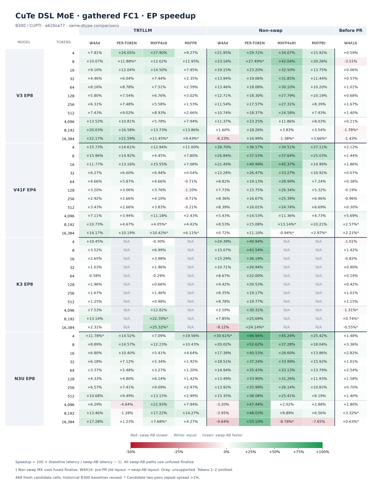
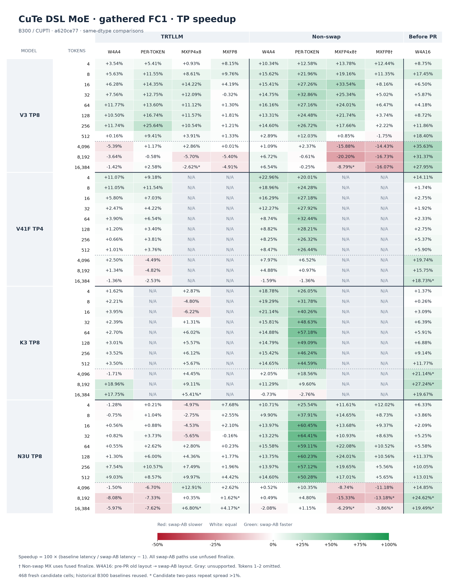

## Archive of upstream PR #7290

@humansand

Preserves the complete pre-squash history and source at `a620ce7790b32f7f0ae524a811417d2c6cee1152`, against its original merge base `002529e17b22567a071091053c6c4dc2a55e050e`. The archive branches remain fixed while [upstream PR #7290](https://github.com/flashinfer-ai/flashinfer/pull/7290) is squashed and rebased. Historical measurements below refer to their stated commits.

---

<!-- .github/pull_request_template.md -->

## 📌 Description

@humansand

Add opt-in `swap_ab=True` to Blackwell (SM100/SM103) split CuTe DSL MoE: weights on MMA A, activations on B, dynamic MMA N, and FC1 input gathering inside the GEMM. Existing non-swap blockscaled kernels remain the default. W4A16 uses the new input-gathering path with either weight layout.

- **Input pipeline:** a dedicated four-warp group gathers original token rows, removing standalone activation permutation and its expanded input buffer. Swap-AB uses TMA gather4 for values and predicated asynchronous word copies for scale factors; W4A16 gathers BF16 values with TMA. Routing metadata remains separate; FC2 keeps regular TMA loads.
- **Kernel organization:** swap-AB FC1 has control, epilogue and gather warpgroups. W4A16 adds gathering as its fifth, final warpgroup. Role-specific register budgets and compile-time buffer sizing preserve staged loading, multicast, CLC and PDL; FC2 can prefetch weights/scales before its activation dependency is ready. Only writer warps commit FC2 TMA stores; MMA scale descriptors use compile-time IDs. Ordinary operand `producer_tail` calls and the linear quantization maximum remain.
- **API/layout:** select the same `swap_ab` mode for weight preparation and execution. Gated FC1 uses up16/gate16 rows; W4A16 also supports the original up64/gate64 layout through in-kernel transpose. NVFP4 W4A4/per-token, MXFP4x8 (`w4a8`) and MXFP8 (`mxfp8`) are supported. Swap-AB keeps one shared FC1/FC2 CLC autotune choice; W4A16 tactics are unchanged. Nongated FC1 joins converted fragments through integer registers for wider FP4/FP8 stores, preserving scale/conversion order.
- **Reuse:** share routing, combine, the per-token quantizer and Blackwell utilities. The shared W4A16 dequantizer duplicates each scale byte with one PRMT. W4A16 pairs SiTU RN arithmetic and skips wholly unused K-transform groups with a per-group stage cutoff; all phase transitions remain. MegaMoE explicitly retains its padded-K transform extent. Keep fused activation/requantization, compile-time partial-K handling, SM103 NVFP4 K96 MMA, zero-tolerance swap-AB accuracy coverage and the manual sanitizer script. No separate prepare or inline-PTX module remains.

Whole-PR diff at `a620ce77` against merge base `002529e1` (29 files):

| Component | Added | Removed |
|---|---:|---:|
| Swap-AB kernel, launcher and tactics | 4,361 | 0 |
| W4A16 implementation | 908 | 853 |
| Shared pipeline, combine, quantizer and utilities | 485 | 200 |
| Public API, dispatch and weight preparation | 382 | 114 |
| Benchmark scripts | 1,109 | 487 |
| Tests and references | 1,565 | 112 |
| Standalone sanitizer script | 706 | 0 |
| Documentation and trace template | 73 | 37 |
| **Total** | **9,589** | **1,803** |

**End-to-end performance.** All 468 supported split-MoE cases are freshly measured at merged head **`a620ce77`**, with unfused finalize; no older candidate rows are reused. Positive percentages mean faster: `100 × (baseline latency / candidate latency − 1)`; candidate latency is the geometric mean of two CUPTI pass medians. Original historical B300 TRTLLM, non-swap and pre-PR W4A16 baselines are reused across instances. Tokens 1–2 remain in raw output but are excluded from heatmaps and aggregates.





† Non-swap MX baselines use fused finalize where required. W4A16 compares the pre-PR old layout with the new layout. Gray means unsupported; TRTLLM BF16 is omitted because there is no matching candidate dtype.

[Full numerical speedup tables](https://raw.githubusercontent.com/zianglih/flashinfer/8cfecaf8964ffe61dfa6864c9b5250dfe298dac2/a620ce77/numerical-tables.md) · [Absolute baseline/candidate latencies](https://raw.githubusercontent.com/zianglih/flashinfer/8cfecaf8964ffe61dfa6864c9b5250dfe298dac2/a620ce77/benchmark-comparisons.csv) · [Fresh raw results and native stdout](https://raw.githubusercontent.com/zianglih/flashinfer/8cfecaf8964ffe61dfa6864c9b5250dfe298dac2/a620ce77/publication-evidence.tar.xz) · [Immutable historical dependencies](https://raw.githubusercontent.com/zianglih/flashinfer/8cfecaf8964ffe61dfa6864c9b5250dfe298dac2/a620ce77/dependencies.json)

### Benchmark table output

The benchmark's unchanged table printer combines all 468 fresh final-pass CuTe DSL records with original TRTLLM records. TRTLLM was not rerun; unsupported or unmeasured entries remain N/A. The heatmaps use two-pass aggregates. Tokens 1–2 remain in the script output.

- [V3 EP8 / V41F EP4](https://github.com/flashinfer-ai/flashinfer/pull/7290#issuecomment-6519314397)
- [K3 EP8 / N3U EP8](https://github.com/flashinfer-ai/flashinfer/pull/7290#issuecomment-6519315021)
- [V3 TP8 / V41F TP4](https://github.com/flashinfer-ai/flashinfer/pull/7290#issuecomment-6519315606)
- [K3 TP8 / N3U TP8](https://github.com/flashinfer-ai/flashinfer/pull/7290#issuecomment-6519316131)

**Measurement.** Rank-local EP/TP simulation without communication; public functional API; 10 warmups and 100 strict-CUPTI cold-L2 CUDA-graph samples per pass; two fresh processes; frozen recorded choices, including ten existing W4A16 defaults; no retuning or event fallback. NVFP4 includes initial quantization; W4A16 consumes BF16 directly. Per-token uses MSE 4over6, 256 scaling and error fast math, with base FP4 fast math disabled.

8×NVIDIA B300 SXM6 AC on C2, `fi-gather-pipeline-resume-1030`; `nvcr.io/nvidia/pytorch:26.05-py3`; CUDA 13.2.1, driver 595.91.07, installed PyTorch `2.12.0a0+5aff3928d8.nv26.5.50603568`, CuTe DSL 4.8.0 and CUPTI Python 13.2.0. This refresh uses the recorded current release cohort (`moe_utils` ELF `046552b8…`) and private source-bound CuTe caches. Historical denominators were measured on earlier instances/cohorts; this is a historical end-to-end comparison, not a fresh causal measurement of each retained change.

93,600 fresh candidate samples; maximum A-A median spread 8.62%. Stock clocks are unchanged. 98/3,744 sample-quartile windows had median SM clocks other than 2032 MHz or nonzero clock-event reasons; NVML observations were missing for 1 window. All negative results are retained. Small differences at variable points are inconclusive; two passes do not establish statistical confidence.

```bash
export FLASHINFER_CUDA_ARCH_LIST=10.3a FLASHINFER_CUTE_DSL_STRICT_CACHE_KEY=1
export FLASHINFER_DIST_AWARE_AUTOTUNE=0 TRTLLM_ENABLE_PDL=1
export FLASHINFER_DISABLE_FP4_QUANT_FAST_MATH=0 TRTLLM_DISABLE_FP4_QUANT_FAST_MATH=0
export CUTE_DSL_CACHE_DIR=/data/flashinfer-cache/cute-dsl

python benchmarks/bench_moe_deepseek.py \
  --functional-api --model v3 --ep 8 --tp 1 --quant-family nvfp4 \
  --backends cutedsl,cute-dsl-per-token --swap-ab --no-fused-finalize \
  --num-tokens 1,2,4,8,16,32,64,128,256,512,4096,8192,16384 \
  --include-activation-quant --cache /path/to/frozen-winners \
  --warmup 10 --iters 100 --no-autotune --output-format both
```

Other presets: `v41-flash` (EP/TP4), `kimi-k3` and `nemo3-ultra` (EP/TP8); TP uses `--ep 1 --tp N`. MX uses `--quant-family mxfp --backends cute-dsl-w4a8,cute-dsl-mxfp8` without initial quantization. K3 MXFP8 and V41F TP MX have no supported external comparisons and are skipped. The archived observation wrapper enforces CUPTI, each backend's quantization contract and the frozen choices; standard command output alone is not an event-fallback guard. The archive includes all 62 original both-format process logs and the exact measured commands/configuration.

**Historical shared-helper evidence.** The following comparison was measured at `4376662a` for the single-PRMT scale duplication still present in this merge. The MegaMoE padded-K handoff has representative byte-identical native qualification; no distributed timing was rerun for this refresh.

### Shared W4A16 dequantizer: GLM5 MegaMoE

Following [#6277](https://github.com/flashinfer-ai/flashinfer/pull/6277), this isolates the shared scale-duplication change: both arms use production `4376662a`; **before** restores only `moe_w4a16_utils.py` from the parent of `1e4b127a`, and **after** keeps the current helper. MegaMoE inherits this dequantizer through `_MegaMixedInput._transform_tile`.

- **Workload:** real EP8 on 8×B300 SXM6 AC, D6144/I2048, 256 experts, top8, SwiGLU, grouped routing 8/top4, scaling 2.5. Precomputed routes; PDL and fused deterministic combine enabled; in-kernel FC2 reduction disabled.
- **Measurement:** one control AUTO selection per token count, then the same frozen tactics/routes in four fresh process groups, C1→A1→A2→C2. Each uses 3 warmups and 100 untrimmed cold-L2 CUDA-graph CUPTI samples, aggregated by rank-MAX per iteration. Each reported latency is the median of 200 samples per arm; speedup=`before/after−1`. Tokens 1/2 are measured but excluded from aggregates.
- **Environment:** `nvcr.io/nvidia/pytorch:26.05-py3`, CUDA 13.2, driver 595.91.07, PyTorch `2.12.0a0+5aff3928d8.nv26.5.50603568`, CuTe DSL 4.8.0, CUPTI Python 13.2.0/library 13.2.86, NVSHMEM4Py 0.3.1/library 3.6.5. Native C++ compilation artifacts are retained outside timing.

Geomean speedup: **+1.54% overall**, **+1.79% decode (4–512)** and **+0.89% prefill (4096–16384)**. All three pooled prefill points improve. Decode is mixed: 4/8/32 tokens regress by 2.53%/1.21%/3.89%, while repeat-phase median spreads reach 11.37%; this does **not** establish uniform per-shape non-regression.

| Global tokens | Before (µs) | After (µs) | Speedup |
|---:|---:|---:|---:|
| 1 | 70.913 | 71.681 | -1.07% |
| 2 | 91.073 | 88.177 | +3.28% |
| 4 | 100.465 | 103.073 | -2.53% |
| 8 | 113.873 | 115.265 | -1.21% |
| 16 | 136.545 | 125.472 | +8.82% |
| 32 | 144.850 | 150.705 | -3.89% |
| 64 | 167.328 | 161.907 | +3.35% |
| 128 | 175.058 | 171.089 | +2.32% |
| 256 | 176.305 | 167.905 | +5.00% |
| 512 | 181.362 | 176.049 | +3.02% |
| 4096 | 404.210 | 403.027 | +0.29% |
| 8192 | 690.740 | 676.068 | +2.17% |
| 16384 | 1271.803 | 1269.000 | +0.22% |

For the representative 16384-token native MegaMoE specialization, SASS instruction count is 6400→6384 and PRMT count 197→181; all other opcode counts match. Both use 96 registers and zero stack/local memory. The audited sequence replaces 16 two-PRMT scale duplications with 16 single-PRMT duplications; this codegen statement is scoped to that specialization.

[All raw samples](https://raw.githubusercontent.com/zianglih/flashinfer/2402bcd61a7cc39f650f6b92dd1aa2293ee50518/pr7290/2026-10-29/glm5-helper-4376662a/raw-samples.csv), [per-phase statistics](https://raw.githubusercontent.com/zianglih/flashinfer/2402bcd61a7cc39f650f6b92dd1aa2293ee50518/pr7290/2026-10-29/glm5-helper-4376662a/summary.csv), [native timing output](https://raw.githubusercontent.com/zianglih/flashinfer/2402bcd61a7cc39f650f6b92dd1aa2293ee50518/pr7290/2026-10-29/glm5-helper-4376662a/native-timing-output.txt), [source/runtime provenance](https://raw.githubusercontent.com/zianglih/flashinfer/2402bcd61a7cc39f650f6b92dd1aa2293ee50518/pr7290/2026-10-29/glm5-helper-4376662a/provenance.json), [native codegen proof](https://raw.githubusercontent.com/zianglih/flashinfer/2402bcd61a7cc39f650f6b92dd1aa2293ee50518/pr7290/2026-10-29/glm5-helper-4376662a/codegen-proof.json).

**Raw phase medians and reproduction**

|Tokens|C1 µs|A1 µs|A2 µs|C2 µs|
|---:|---:|---:|---:|---:|
|1|75.857|73.841|70.160|64.433|
|2|85.473|90.785|84.737|94.801|
|4|100.401|98.849|105.744|100.817|
|8|109.297|109.648|122.113|119.377|
|16|140.450|126.849|124.049|132.769|
|32|140.657|149.762|151.761|151.826|
|64|171.150|161.154|163.105|164.034|
|128|174.610|166.545|174.497|175.538|
|256|175.953|168.305|167.266|176.642|
|512|181.953|176.577|175.857|180.802|
|4096|401.890|404.498|400.676|406.402|
|8192|696.260|669.108|677.204|681.299|
|16384|1281.896|1270.504|1267.499|1264.030|

The [local benchmark wrapper](https://raw.githubusercontent.com/zianglih/flashinfer/2402bcd61a7cc39f650f6b92dd1aa2293ee50518/pr7290/2026-10-29/glm5-helper-4376662a/native_frozen.py) only installs the [frozen per-token tactics](https://raw.githubusercontent.com/zianglih/flashinfer/2402bcd61a7cc39f650f6b92dd1aa2293ee50518/pr7290/2026-10-29/glm5-helper-4376662a/frozen-tactics.json) and records untimed route fingerprints; timed forwards use `benchmarks/bench_cute_dsl_moe_distributed.py` unchanged. For each source arm, point `MEGA_SOURCE`/`PYTHONPATH` at its checkout and `MEGA_FROZEN_TACTICS` at the downloaded JSON, then run:

```bash
export CUDA_VISIBLE_DEVICES=0,1,2,3,4,5,6,7
export FLASHINFER_CUDA_ARCH_LIST=10.3a FLASHINFER_DIST_AWARE_AUTOTUNE=0
export FLASHINFER_NVFP4_4OVER6=1 FLASHINFER_NVFP4_4OVER6_E4M3_USE_256=1
export FLASHINFER_NVFP4_4OVER6_ERR_MODE=MSE FLASHINFER_NVFP4_4OVER6_ERR_USE_FAST_MATH=1
export FLASHINFER_DISABLE_FP4_QUANT_FAST_MATH=1
export PYTHONWARNINGS='error:CUPTI is not installed:UserWarning'
torchrun --master-addr=127.0.0.1 --master-port=29672 --nproc-per-node=8 \
  native_frozen.py --model glm5 --mode benchmark --parallel-modes ep \
  --num-gpus 8 --variants w4a16_megamoe \
  --num-tokens 1,2,4,8,16,32,64,128,256,512,4096,8192,16384 \
  --timing cupti --cuda-graph --precomputed-routing --no-fused-finalize \
  --warmup 3 --iters 100 --log-timing-samples --megamoe-knobs auto
```

The wrapper replaces `auto` with the same frozen knob dictionary before constructing each layer. All 52 timing records, 416 per-rank tactic records and 416 route fingerprints passed validation; no CUPTI fallback occurred. Benchmark results are a performance check of the shared helper, not a new numerical or sanitizer qualification.


## 🔍 Related Issues

Builds on merged [#7196](https://github.com/flashinfer-ai/flashinfer/pull/7196) and [#7501](https://github.com/flashinfer-ai/flashinfer/pull/7501). Incorporates the input-gathering work from [zianglih/flashinfer#8](https://github.com/zianglih/flashinfer/pull/8). NVFP4 epilogue/reference contracts follow [#7372](https://github.com/flashinfer-ai/flashinfer/pull/7372).

## 🚀 Pull Request Checklist

Thank you for contributing to FlashInfer! Before we review your pull request, please make sure the following items are complete.

### ✅ Pre-commit Checks

- [x] I have installed `pre-commit` by running `pip install pre-commit` (or used your preferred method).
- [ ] I have installed the hooks with `pre-commit install`.
- [ ] I have run the hooks manually with `pre-commit run --all-files` and fixed any reported issues.

> If you are unsure about how to set up `pre-commit`, see [the pre-commit documentation](https://pre-commit.com/).

## 🧪 Tests

- **Current merged head `a620ce77`:** seven existing zero-tolerance smoke calls passed, covering W4A16 layouts/tails/SiTU/ReLU², W4A4 ReLU², per-token native CLC, MXFP4x8 and MXFP8. All 21 captured native kernels have zero local memory; normal compiler options, full-source postflight and current native-cache identity passed. Test-only small-SM/scheduler fixtures are confined to smoke subprocesses and are absent from performance runs.
- **Historical whole-suite validation:** the earlier cleanup measured at `326c4a79` passed 128 candidate cases (36 focused smokes + 92 existing tests), 16 paired controls, and 48 paired native-kernel equality checks. These are preserved historical results, not a rerun on this merge. Retained follow-ups have their own exact/native evidence in the immutable dependency archive.
- **Utilities/hooks:** earlier 63 CPU benchmark-format checks and 15 actual CuTe DSL 4.8 sanitizer-option parser checks remain historical. The refreshed table formatter is AST-identical, and current numerical joins are independently replayed. Merge-scoped hook results are recorded separately.
- **Sanitizer/distributed boundary:** 150 sanitizer cases were historically collected but not executed. No new sanitizer run or distributed GLM5 benchmark was performed for this refresh.

## 🔬 Experimental Track

<!-- Only for PRs submitted under the experimental policy (CONTRIBUTING.md → "Experimental APIs and Backends").
     Leave this section untouched for normal PRs. -->

- [ ] This PR is **experimental**: it adds or changes code under `flashinfer/experimental/` and/or an `@flashinfer_experimental_api`. Tracking issue: #
  - [ ] The tracking issue names an owner, the reason for the experimental path, and a graduation plan with a target release.
  - [ ] Core changes are limited to a thin entry point (signature, shared validation, feature-gate check, backend selection, handoff).
  - [ ] Tests live in `tests/experimental/` and were validated on the intended hardware; a runnable example is included.
  - [ ] Nothing is registered in `flashinfer/aot.py`, and no experimental backend is reachable from `backend="auto"` without `FLASHINFER_ALLOW_EXPERIMENTAL_AUTO_BACKENDS=1`. (Calling an `@flashinfer_experimental_api` or naming a backend explicitly is itself the opt-in and needs no environment variable.)
  - [ ] **Test scope declared below.** The experimental CI lane runs exactly these targets, so keep them as narrow as the change allows.

<!-- Required for experimental PRs. Replace the commented lines below with your targets.
     Do not delete the fence or change its `experimental-tests` tag — the experimental-track
     watcher reads it verbatim to decide which targets to ask CI for. -->

```experimental-tests
# One target per line: a directory or a file. (A pytest ::selector is not
# supported -- the sharding runner cannot consume one.) Must be under
# tests/experimental/ and must exist. Delete these comment lines and add yours, e.g.
#
#   tests/experimental/test_my_backend.py
#   tests/experimental/my_backend/
#
# Declaring the whole tree (tests/experimental/) is allowed but means every
# experimental PR pays for every other feature's tests, in every matrix cell.
```

## Reviewer Notes

Review FC1 gather publication/multicast accounting, register ownership and legacy layout handling. No model-specific dispatch or new CLC autotune axis is added.


<!-- This is an auto-generated comment: release notes by coderabbit.ai -->
<!-- coderabbit-ai-generated:v1 -->

## Summary by CodeRabbit

* **New Features**
  * Added an opt-in Blackwell execution mode for CuTe DSL MoE, with support for additional activation and quantization combinations, including SiTU with MXFP4 and MXFP8.
  * Added support for preparing gated weights for the new execution mode and for W4A16 routed-input processing.
  * Expanded per-token NVFP4 quantization options, including row selection and grouped scale outputs.
  * Expanded MoE benchmarks with additional model presets, quantization comparisons, and table or CSV output.
* **Documentation**
  * Clarified activation support and configuration requirements for SiTU on SM100/SM103.
<!-- end of auto-generated comment: release notes by coderabbit.ai -->
