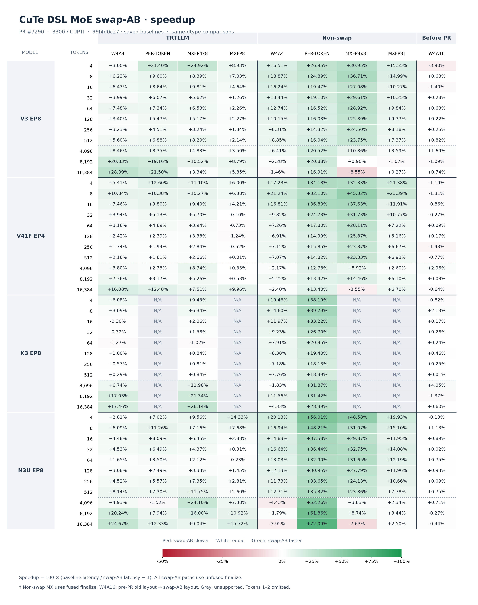
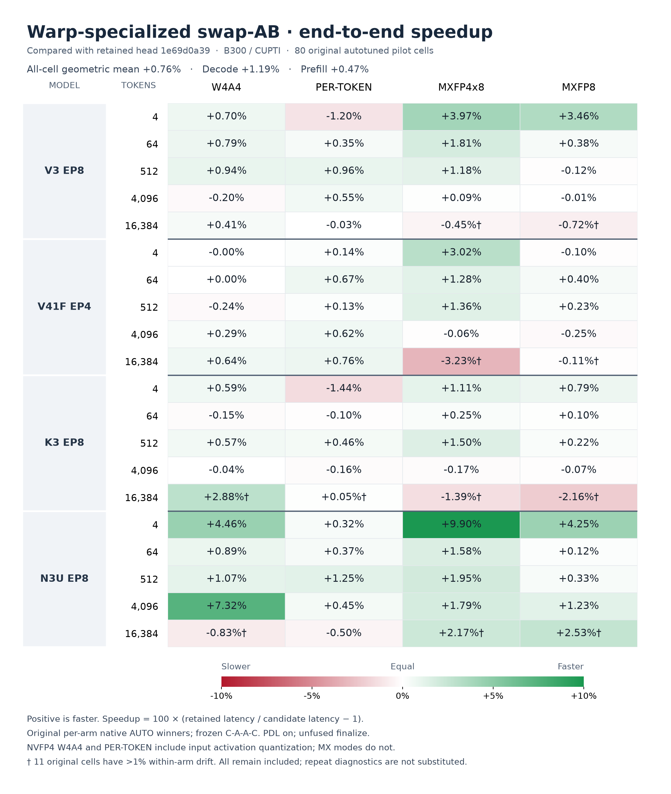

# PR7290 heatmap assets

The current PR body embeds only the full 44×9 end-to-end heatmap from asset commit `36fe7fa7269b3ccf068028044d4d64392c3b3649`. Its PNG SHA256 is `b951565ac432477516fce3770ecaa357a72dafbfd1e29a2fbf6148597c5a11e9`; the immutable download was verified. See `final-publication-receipt.json` and `../full-rerun/publication-receipt.json`.

The pilot publication below is historical and is not embedded in the PR body.

The final 44×9 end-to-end heatmap is published at asset commit
`36fe7fa7269b3ccf068028044d4d64392c3b3649` on the same image-only branch.
Only this final image belongs in the PR body:

```markdown

```

`final-publication-receipt.json` binds the approved plot manifest, source CSV,
blob/tree/commit identities and immutable download verification. The downloaded
1,138,563-byte PNG has SHA256
`b951565ac432477516fce3770ecaa357a72dafbfd1e29a2fbf6148597c5a11e9`.
The summary consistently uses saved baseline timings and fresh clean `99f4`
CuTe timings. No PR source, body or comment was changed by image publication.

## Historical pilot asset

The approved pilot PNG is published on the image-only branch
`zianglih/flashinfer:codex/pr7290-benchmark-assets`, separate from the PR source branch.
Its orphan asset commit is `fa02da74363f9507bb321eb6154c7d87dcc630b4`.

```markdown

```

The public immutable download is byte-identical to the visually reviewed source:
429,151 bytes, SHA256
`c071d84e3a2ecd6692e324d6c544c3bdf0515c5f028b51f08254866630906ec9`.
`pilot-publication-receipt.json` records the source, commit/tree/blob identity,
download verification, and unchanged PR head/body. The publication helper and
GitHub API responses are retained here; no source checkout was modified.

The original pilot remains in branch history and was preserved unchanged in the
final asset commit. The corrected local pilot and prior-head comparison are not
part of the final publication. Image files stay outside the PR source branch.
